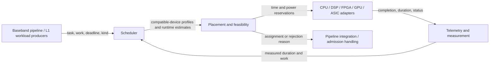
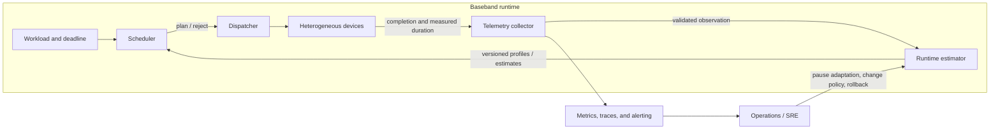
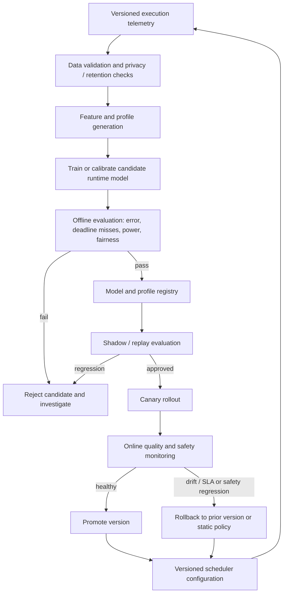

# AI-Driven Heterogeneous Resource Scheduling for Baseband

A design and prototype for assigning time-critical baseband processing workloads to heterogeneous compute resources using deadline-aware, power-constrained scheduling and online runtime feedback.

> **What this project schedules:** compute tasks such as channel estimation, beamforming, and decoding across CPUs, DSPs, FPGAs, GPUs, or dedicated accelerators. It is not a 3GPP MAC scheduler and does not allocate radio resource blocks to UEs. The included Python implementation is a scheduling simulation/control-plane foundation, not a production real-time executor.

## Problem and design goals

Baseband pipelines have a changing mix of workloads, and their execution cost varies with workload size, configuration, hardware, and operating conditions. A static device choice can leave capacity idle or miss a processing deadline. A resource scheduler needs to decide **where and when** to run each eligible task while preserving timing and platform constraints.

The prototype demonstrates these goals:

- **Deadline feasibility:** admit tasks only when the estimated completion fits the task's absolute deadline.
- **Heterogeneous placement:** use per-accelerator, per-workload execution profiles; a device is eligible only for workload kinds it supports.
- **Online adaptation:** update execution-time-per-work-unit estimates from measured completions using an exponentially weighted moving average (EWMA).
- **Resource safety:** prevent overlapping tasks on the same accelerator and enforce a configurable sum of active power across overlapping reservations.
- **Explainability:** return an assignment or a rejection with a reason, rather than silently dropping a task.
- **Energy-aware choice:** rank feasible candidates by a configurable completion-time/energy score.

The design is intentionally small and deterministic to make the scheduling policy understandable and testable. It is **model-based adaptive scheduling**, not a trained neural-network policy. “AI-driven” here refers to the adaptive runtime model that uses execution feedback; no offline training pipeline or learned placement policy is included in the prototype.

## System context



This view separates **radio scheduling** from **compute scheduling**. The calling system supplies baseband tasks and their timing budget; this library assigns those tasks to modeled accelerators. A production integration must connect the plan to actual dispatch, completion reporting, and deadline/failure handling.

## Scheduling behavior in this repository

`scheduler.py` exposes `Accelerator`, `Performance`, `Workload`, `AdaptiveScheduler`, and the `Schedule` result.

1. A workload declares a unique task ID, workload kind, positive work quantity, and absolute deadline in microseconds on the caller's monotonic clock.
2. The scheduler processes each submitted batch in earliest-deadline-first (EDF) order, with task ID as a deterministic tie-breaker.
3. For each compatible accelerator, it estimates duration from the learned time per work unit. It checks available reservation boundaries, device serialization, deadline feasibility, and the active-power budget.
4. It chooses the lowest-scoring feasible candidate. The score is completion time relative to the current scheduling time plus a normalized energy penalty; `energy_weight=0` prefers earliest completion, while larger values favor lower-energy candidates.
5. It returns assignments and explicit rejections. Accepted reservations remain active across calls until their predicted finish time.
6. The caller reports measured execution duration through `observe()`. The EWMA update is `new = (1 - learning_rate) * old + learning_rate * measured_duration/work` and affects future plans only.

The supplied accelerator profiles and simulation values are illustrative, not benchmark results or hardware guarantees. All times use the same caller-controlled clock. Work units must be consistent within a workload kind, deadlines are absolute, and observations should measure execution time rather than queue waiting time.

### Example

```python
from scheduler import Accelerator, AdaptiveScheduler, Performance, Workload

scheduler = AdaptiveScheduler(
    [
        Accelerator("gpu", {"beamforming": Performance(80, 120)}),
        Accelerator("dsp", {"beamforming": Performance(140, 25)}),
    ],
    power_budget_w=150,
)

plan = scheduler.schedule(
    [Workload("beam-1", "beamforming", work=1, deadline_us=200)],
    now_us=0,
)
for assignment in plan.assignments:
    print(assignment.accelerator, assignment.start_us, assignment.finish_us)
for rejection in plan.rejected:
    print(rejection.workload.task_id, rejection.reason)

# Feed an execution measurement into the runtime estimator.
scheduler.observe("gpu", "beamforming", work=1, duration_us=240)
```

Run the illustrative simulation and standard-library tests from the repository root (Python 3.10+; no installation required):

```sh
python scheduler.py
python -m unittest -v test_scheduler
```

## Software designer guidance

### Workload and resource contracts

| Concept | Prototype contract | Production integration consideration |
|---|---|---|
| Workload kind | String key used to find compatible profiles | Define a versioned taxonomy (for example, channel estimation mode, FFT size, antenna count, decoder configuration); avoid mixing incomparable work units. |
| Work amount | Positive scalar multiplied by runtime per unit | Normalize units and include configuration-dependent cost; validate inputs at the producer boundary. |
| Deadline | Absolute timestamp on a monotonic microsecond clock | Derive it from the actual pipeline processing budget and remaining slack. Keep clock domains consistent and account for dispatch, transfer, synchronization, and completion-reporting overhead. |
| Accelerator profile | Initial runtime per work unit and active power for one workload kind | Calibrate by hardware model, software/firmware version, configuration, and operating range. Profiles are assumptions, not guarantees. |
| Measurement | Actual duration and work for a completed execution | Correlate with task/profile versions; reject stale, invalid, or mismatched samples and monitor estimate error. |
| Power budget | Sum of active profile power for overlapping reservations | Reserve idle/platform power separately; define the scope of the cap and reconcile estimates against platform power telemetry. |

### Decision and failure paths

- **No compatible accelerator:** the workload kind has no configured profile.
- **No feasible slot:** deadline or active-power constraints leave no candidate; a profile that individually exceeds the configured budget is also infeasible.
- **Execution overrun:** the prototype reserves predicted intervals and does not revise an existing reservation after feedback. A production dispatcher needs runtime watchdogs, overrun accounting, re-planning/admission policy, and a defined dependent-task response.
- **Unavailable or degraded device:** the prototype has no health state or failover logic. Integrations should remove or derate unhealthy capacity before planning and define behavior for device loss after dispatch.
- **Concurrency:** calls to one scheduler instance must be serialized. A service wrapper must provide synchronization or single-owner scheduling; thread safety is not provided by the class.
- **Admission ownership:** decide whether rejected tasks are retried, routed to a fallback, degraded, or dropped. Do not retry blindly if the deadline has already expired.

### Current boundaries

The implementation models non-preemptible tasks, one task at a time per accelerator, simple workload profiles, and a single aggregate active-power limit. It does not model task dependencies, queues beyond its reservations, preemption, memory/bandwidth limits, data movement, device health, simultaneous kernels, idle power, thermal limits, or dispatch overhead unless those effects are reflected in supplied profiles. Its greedy EDF/score policy is not globally optimal and offers no hard real-time guarantee. Profile error, workload drift, and overruns can invalidate predicted feasibility.

## MLOps and model lifecycle

The current runtime estimator is in-memory EWMA state. The repository does **not** contain a model registry, durable telemetry store, training job, deployment service, or automated rollback. The diagrams below describe a production-oriented extension; they are architecture guidance, not implemented components.

### Operational feedback and controlled adaptation



Keep the control loop bounded and observable: measure scheduling latency separately from task execution, record predicted versus actual duration, and avoid allowing delayed or malformed telemetry to corrupt estimates. Consider per-profile sample counts and confidence/uncertainty before adapting production decisions; the current EWMA does not represent uncertainty.

### Offline MLOps lifecycle for future learned models



For an eventual learned policy, treat models and hardware profiles as versioned release artifacts. Evaluate candidates on representative hardware/workload traces and include deadline-miss rate, tail latency, rejection rate, accelerator utilization, energy, and estimate calibration—not only average throughput. Start with replay and shadow modes, then a constrained canary with a deterministic fallback. Define hard safety gates outside the model: compatibility, deadline and power checks, input validation, and operational rollback must remain enforceable even when model output is incorrect.

## Suggested production acceptance criteria

Set thresholds from the target platform and service requirements; the repository does not supply universal values. At minimum, measure scheduler decision latency and its tail, predicted-versus-measured runtime error by profile, deadline miss and rejection rates, per-device utilization, energy/power budget violations, stale/invalid observation rates, and fallback/overrun frequency. Exercise profile drift, overload, empty or unsupported workloads, clock monotonicity, device degradation, and rollback in tests before enabling live adaptation.
